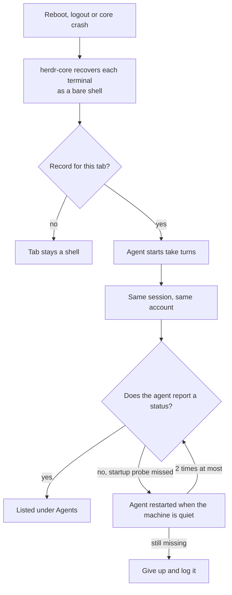
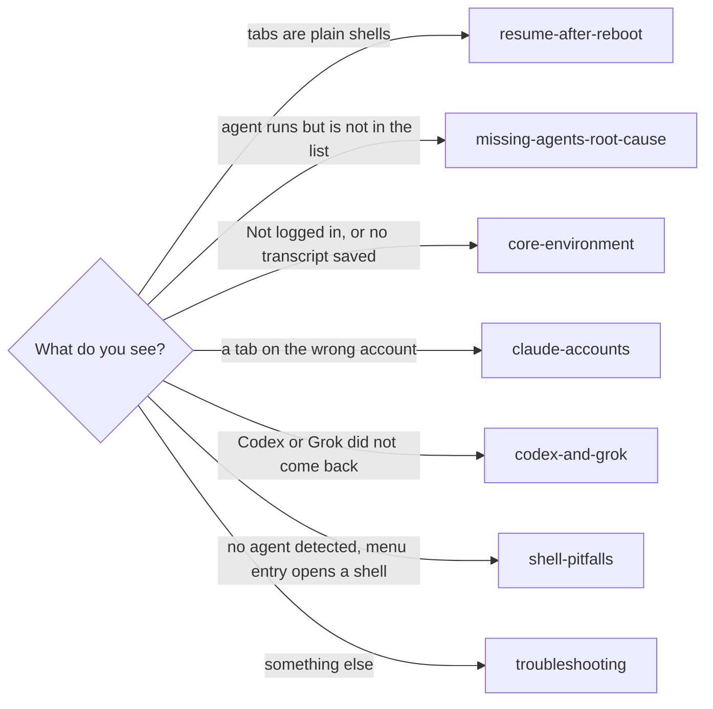

# Herdr Agents Field Guide

[Tiếng Việt](README.md) · **English**

Field notes from running many coding agents (Claude Code, Codex, Grok) in the tabs of the Herdr app / herdr-core (`hc`): where the agents go after a reboot, why a running agent can be missing from the Agents list, and how far the fixes were verified.

The repository holds **documentation, one small tool (`hc-claude-resume`) and scripts to reproduce the problems**. It is not an official product and is not affiliated with the makers of Herdr, Claude Code, Codex or Grok.

**Observed between 2026-11-12 and 2026-11-18** on one macOS machine. The versions below are the ones tested, not necessarily the latest. The numbers are a summary by the author from real runs; the raw logs are private and are not published. Reproduce them yourself instead of treating the tables as evidence you can audit.

## What happened

| Reboot | Outcome | Cause found |
|---|---|---|
| First | Tabs, names and folders were intact, but every agent was gone: the tabs were plain shells. Typing the usual "continue" command signed in with the wrong account | herdr-core recovers a terminal as a shell and does not run the old command again |
| Second | Claude Code came back on the right accounts. Codex and Grok did not. Some tabs said "Not logged in" | The core had been started from an ssh connection and could not read the Keychain |
| Third | Every agent came back, but 9 of 14 Claude Code tabs were missing from the Agents list | Claude Code asks the terminal once at startup and waits about 2 seconds. With about 30 agents starting together it read the answer too late, and it never asks again |

The path of one tab after a reboot, with the tool of this repository:



## Main lessons

1. **herdr-core keeps terminals, not agents.** After a loss (reboot, logout, core crash) a tab comes back as a bare shell. To get the agent back you have to record which session ran in which tab, and on which account. See [Resume after a reboot](docs/resume-after-reboot.md).
2. **An agent's status comes only from the agent.** The Agents list is built from OSC 7501 reports that the program in the terminal sends. Nothing outside can set a status. An agent that does not report is invisible.
3. **The root cause of the missing agents is in Claude Code, not in the terminal.** The terminal answers in 0.03 to 0.15 s. Claude Code (2.1.326, 2.1.327) handles the answer after its 2 s deadline when the CPU is contended and settles on "not supported" for the whole session. See [Root cause](docs/missing-agents-root-cause.md).
4. **Spacing the starts is not a fix.** With starts 2 s apart, 2 of 12 were still lost. With one start at a time, 4 of 13 were lost in one run. The first explanation written for this problem was wrong on exactly this point, and that only showed when the reboot was reproduced and counted.
5. **Until the cause is fixed upstream, detect and repair the damage automatically, with a limit.** The tool watches each resumed tab. A tab that sits at its prompt without a status is restarted with the same session once the machine is quiet, twice at most, then the tool stops and logs it. A tab that is busy, shows a dialog or has a draft is left alone.
6. **Every tab inherits where the core was born.** Born in an ssh session: no Keychain. Born in an agent's session: every tab is treated as a child session and saves no transcript. See [Core environment](docs/core-environment.md).
7. **Codex in its shared background server cannot be tied to a tab.** `codex --no-daemon` can. New Codex hooks need your own review. See [Codex and Grok](docs/codex-and-grok.md).
8. **Reproduce before you conclude.** Every experiment ran in a separate core (`HC_SESSION=<name>`) with copies of sessions, never in the real tabs. See [Reproduce](docs/reproduce.md).
9. **One Claude account per tab means every command goes through that account's launcher.** Transcripts are shared, so any account can continue any session and nothing warns you. The `claude --resume <id>` line that Claude Code prints at exit moves the session to the default account. See [One account per tab](docs/claude-accounts.md).

## Contents

Every page has mermaid diagrams. Which page for which symptom:



| Path | What it is |
|---|---|
| [docs/missing-agents-root-cause.md](docs/missing-agents-root-cause.md) | Symptom, evidence, what did not work, what is done now |
| [docs/resume-after-reboot.md](docs/resume-after-reboot.md) | How sessions are recorded and resumed, install steps, knobs |
| [docs/claude-accounts.md](docs/claude-accounts.md) | One Claude Code account per tab: long-lived tokens, a settings file and a launcher per account, how to tell which account a tab is on, the wrong-account trap |
| [docs/codex-and-grok.md](docs/codex-and-grok.md) | How Codex and Grok differ, bringing back a tab that was already lost |
| [docs/core-environment.md](docs/core-environment.md) | A core born in ssh, a core born in an agent's session, repair without losing tabs |
| [docs/shell-pitfalls.md](docs/shell-pitfalls.md) | Shell-wrapping plugins, instant prompt, sending text between terminals, the wrong-account trap |
| [docs/custom-menu-entries.md](docs/custom-menu-entries.md) | Adding entries to the Herdr app's + menu without cloning shipped parts |
| [docs/reproduce.md](docs/reproduce.md) | Simulated reboot in a separate core, forced misses, cleanup |
| [docs/observed-results.md](docs/observed-results.md) | What was measured and what was not tested |
| [docs/troubleshooting.md](docs/troubleshooting.md) | By symptom: what to check first, how to fix |
| [docs/privacy.md](docs/privacy.md) | What is published, what was left out, what the tool stores on your machine |
| [bin/hc-claude-resume](bin/hc-claude-resume) | The record and resume tool (Python, one file, standard library only) |
| [shell/](shell) | Snippets for `~/.zshrc` and `~/.zshenv` |
| [examples/](examples) | Hook examples for Claude Code and Codex, an account launcher and its settings file (placeholder only, no token), a LaunchAgent |
| [tools/](tools) | Simulated reboot, functional test, CPU contention and terminal reply timing |
| [tests/](tests) | Tests of the tool's logic and of the documentation (run in CI, no `hc` needed) |

## Quick start

Read [Resume after a reboot](docs/resume-after-reboot.md) before installing. In short:

```sh
cp bin/hc-claude-resume ~/.local/bin/ && chmod +x ~/.local/bin/hc-claude-resume
# 1. Merge examples/claude-settings-hooks.json into ~/.claude/settings.json (back it up first)
# 2. Paste shell/zshrc-resume-trigger.zsh into ~/.zshrc, after your theme and plugins
# 3. Record the Claude Code sessions that are already running:
hc-claude-resume seed
hc-claude-resume list
```

After the next reboot the agent tabs come back one after another. The story of each tab is in `~/.local/state/hc-claude-resume/<core>/events.log`.

Local checks:

```sh
python3 -m unittest discover -s tests -v
```

## Versions tested

| Component | Version |
|---|---|
| herdr-core (`hc`) | 0.1.21 |
| Claude Code | 2.1.326, 2.1.327 |
| Codex CLI | 0.169.1 |
| Grok | 1.0.88 |
| OS, shell | macOS 27.0.1, zsh 5.9 |
| Python | 3.14 (the script also parses on 3.9) |

## Limits

- The start queue and the watcher went through **simulated reboots** in a separate core only, **not through a real reboot yet**.
- Each variant ran once or twice. The numbers show that spacing is not enough; they do not give a failure rate.
- The 2 s deadline and the single probe are behavior observed in the two Claude Code versions above. They are not documented and can change in any release.
- A fresh session (not a resumed one) can still lose its status when it starts on a loaded machine. The tool only watches tabs it resumed.
- Tested on macOS with zsh only.
- The complete fix has to come from Claude Code: accept a late answer, or ask again later.

## Privacy

The repository contains no user names, host names, addresses, real account labels, session ids, conversation text or raw logs. The tool neither stores nor reads tokens. Details, and a checklist for sharing your own findings: [docs/privacy.md](docs/privacy.md).

## License

[MIT](LICENSE). Product names belong to their owners.
