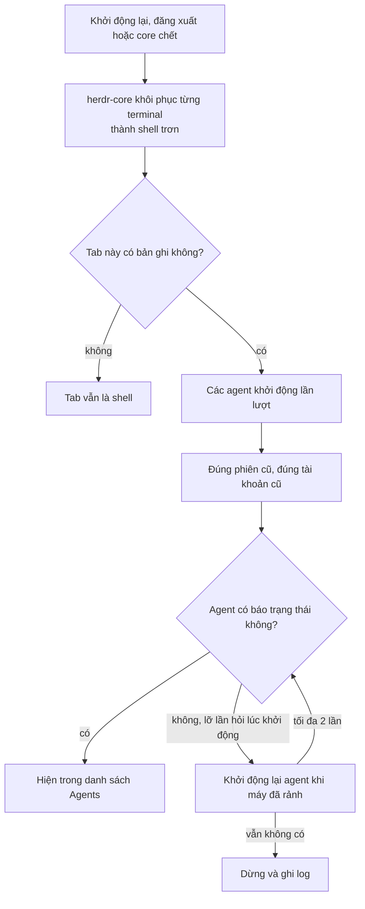
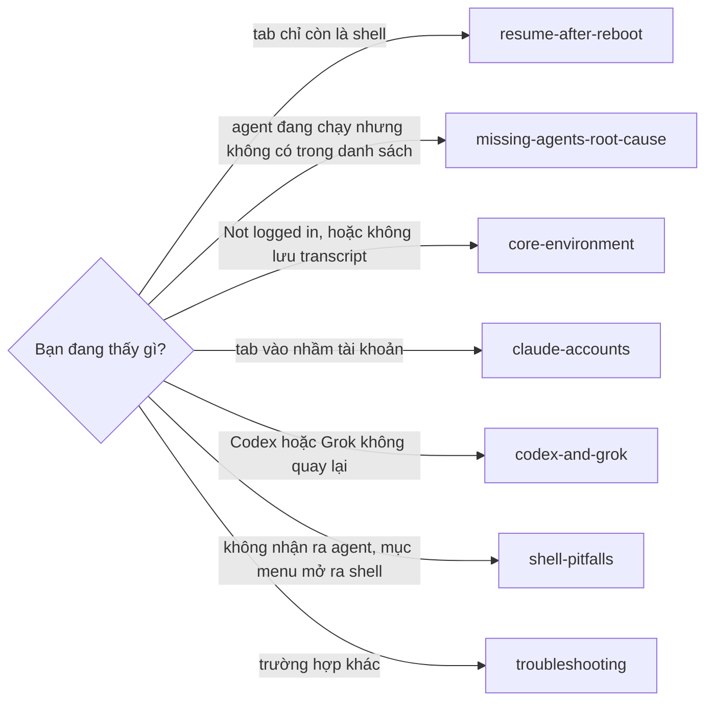

# Herdr Agents Field Guide

**Tiếng Việt** · [English](README.en.md)

Ghi chép thực tế khi chạy nhiều coding agent (Claude Code, Codex, Grok) trong các tab của Herdr app / herdr-core (`hc`): khởi động lại máy xong thì agent đi đâu, vì sao có agent đang chạy mà không hiện trong danh sách Agents, và cách xử lý đã kiểm chứng tới đâu.

Repo gồm **tài liệu, một công cụ nhỏ (`hc-claude-resume`) và bộ script tái lập**. Đây không phải sản phẩm chính thức và không liên kết với nhà phát triển của Herdr, Claude Code, Codex hay Grok.

**Thời gian kiểm chứng: 12 đến 18/11/2026**, trên một máy macOS. Các phiên bản nêu bên dưới là bản đã thử, không mặc định là bản mới nhất. Số liệu do tác giả tổng hợp từ phiên chạy thật; log gốc là dữ liệu riêng tư nên không công khai. Bạn nên tự tái lập thay vì coi các bảng trong repo là bằng chứng có thể kiểm toán độc lập.

## Chuyện đã xảy ra

| Lần khởi động lại | Kết quả | Nguyên nhân tìm ra |
|---|---|---|
| Lần 1 | Tab, tên tab, thư mục còn nguyên, nhưng mọi agent biến mất: tab chỉ còn là shell. Gõ lệnh tiếp tục thì vào nhầm tài khoản | herdr-core chỉ khôi phục terminal thành shell, không chạy lại lệnh cũ |
| Lần 2 | Claude Code tự quay lại đúng tài khoản. Codex, Grok chưa quay lại. Một số tab báo "Not logged in" | Core được tạo từ một kết nối ssh nên không đọc được Keychain |
| Lần 3 | Mọi agent quay lại, nhưng 9 trên 14 tab Claude Code không hiện trong danh sách Agents | Claude Code hỏi terminal đúng một lần lúc khởi động và chỉ chờ khoảng 2 giây. Khi khoảng 30 agent cùng khởi động, nó đọc câu trả lời quá muộn rồi không bao giờ hỏi lại |

Đường đi của một tab sau khi khởi động lại, với công cụ trong repo này:



## Bài học chính

1. **herdr-core giữ terminal, không giữ agent.** Sau khi mất terminal (khởi động lại, đăng xuất, core chết), tab quay lại dưới dạng shell trơn. Muốn agent quay lại phải tự ghi nhớ phiên nào chạy ở tab nào, bằng tài khoản nào. Xem [Resume after a reboot](docs/resume-after-reboot.md).
2. **Trạng thái agent chỉ đến từ chính agent.** Danh sách Agents được dựng từ báo cáo OSC 7501 mà chương trình trong terminal tự gửi. Không có lệnh nào đặt trạng thái từ bên ngoài. Agent không báo thì coi như vô hình.
3. **Nguyên nhân gốc của việc thiếu agent nằm trong Claude Code, không nằm ở terminal.** Terminal trả lời trong 0,03 đến 0,15 giây. Claude Code (2.1.326, 2.1.327) xử lý câu trả lời trễ hơn hạn 2 giây khi CPU bị tranh chấp, chốt "không hỗ trợ" cho cả phiên. Xem [Root cause](docs/missing-agents-root-cause.md).
4. **Giãn cách thời điểm khởi động không phải là cách sửa.** Giãn 2 giây vẫn mất 2 trên 12. Cho từng agent khởi động lần lượt vẫn có lúc mất 4 trên 13. Lời giải thích đầu tiên của chính repo này đã sai ở điểm đó, và chỉ lộ ra khi tái lập rồi đếm.
5. **Chưa sửa được tận gốc thì phải phát hiện và sửa hậu quả một cách tự động, có giới hạn.** Công cụ theo dõi từng tab vừa resume; tab nào đứng yên ở dấu nhắc mà không có trạng thái thì được khởi động lại đúng phiên đó khi máy đã rảnh, tối đa 2 lần, rồi dừng và ghi log. Tab đang bận, đang có hộp thoại hoặc đang gõ dở thì không đụng tới.
6. **Core được sinh ra ở đâu thì mọi tab chịu môi trường ở đó.** Core sinh từ ssh: không đọc được Keychain. Core sinh từ một phiên agent: mọi tab bị coi là phiên con, không lưu transcript. Xem [Core environment](docs/core-environment.md).
7. **Codex chạy bằng server nền dùng chung thì không ghi nhận được tab.** Chạy `codex --no-daemon` thì được. Hook mới của Codex cần chính bạn duyệt. Xem [Codex and Grok](docs/codex-and-grok.md).
8. **Tái lập trước khi kết luận.** Mọi thử nghiệm chạy trong một core riêng (`HC_SESSION=<tên>`), dùng bản sao phiên, không đụng vào tab thật. Xem [Reproduce](docs/reproduce.md).
9. **Mỗi tab một tài khoản Claude thì mọi lệnh phải đi qua launcher của tài khoản đó.** Transcript dùng chung, nên tài khoản nào cũng tiếp tục được phiên nào mà không có cảnh báo. Dòng `claude --resume <id>` mà Claude Code in ra lúc thoát sẽ đưa phiên sang tài khoản mặc định. Xem [One account per tab](docs/claude-accounts.md).

## Trong repo có gì

Tài liệu chi tiết viết bằng tiếng Anh, trang nào cũng có sơ đồ mermaid. Gặp triệu chứng nào thì đọc trang nào:



| Đường dẫn | Nội dung |
|---|---|
| [docs/missing-agents-root-cause.md](docs/missing-agents-root-cause.md) | Triệu chứng, bằng chứng, những cách đã thử mà không hiệu quả, cách xử lý hiện tại |
| [docs/resume-after-reboot.md](docs/resume-after-reboot.md) | Cơ chế ghi nhớ và resume, cách cài, các tham số |
| [docs/claude-accounts.md](docs/claude-accounts.md) | Mỗi tab một tài khoản Claude Code: token dài hạn, file cài đặt và launcher theo tài khoản, cách biết tab đang dùng tài khoản nào, bẫy nhầm tài khoản |
| [docs/codex-and-grok.md](docs/codex-and-grok.md) | Khác biệt của Codex và Grok, cách khôi phục tab đã mất |
| [docs/core-environment.md](docs/core-environment.md) | Core sinh từ ssh, core sinh từ một phiên agent, cách sửa mà không mất tab |
| [docs/shell-pitfalls.md](docs/shell-pitfalls.md) | Plugin bọc shell, instant prompt, gửi lệnh giữa các terminal, bẫy nhầm tài khoản |
| [docs/custom-menu-entries.md](docs/custom-menu-entries.md) | Thêm mục vào menu + của Herdr app mà không phải sao chép thành phần gốc |
| [docs/reproduce.md](docs/reproduce.md) | Giả lập khởi động lại trong core riêng, ép lỗi để thử đường sửa, dọn dẹp |
| [docs/observed-results.md](docs/observed-results.md) | Số liệu đã đo và những gì chưa kiểm |
| [docs/troubleshooting.md](docs/troubleshooting.md) | Tra theo triệu chứng: kiểm gì trước, sửa thế nào |
| [docs/privacy.md](docs/privacy.md) | Repo công khai gì, cố ý bỏ gì, công cụ lưu gì trên máy bạn |
| [bin/hc-claude-resume](bin/hc-claude-resume) | Công cụ ghi nhớ và resume (Python, một file, không phụ thuộc thư viện ngoài) |
| [shell/](shell) | Các đoạn dán vào `~/.zshrc` và `~/.zshenv` |
| [examples/](examples) | Mẫu hook cho Claude Code và Codex, mẫu launcher và file cài đặt theo tài khoản (chỉ có chỗ giữ chỗ, không có token), mẫu LaunchAgent |
| [tools/](tools) | Script giả lập khởi động lại, thử chức năng, đo tranh chấp CPU, đo thời gian terminal trả lời |
| [tests/](tests) | Kiểm tra logic của công cụ và kiểm tra tài liệu (chạy được trên CI, không cần `hc`) |

## Dùng nhanh

Đọc [Resume after a reboot](docs/resume-after-reboot.md) trước khi cài. Tóm tắt:

```sh
cp bin/hc-claude-resume ~/.local/bin/ && chmod +x ~/.local/bin/hc-claude-resume
# 1. Gộp examples/claude-settings-hooks.json vào ~/.claude/settings.json (nhớ sao lưu trước)
# 2. Dán shell/zshrc-resume-trigger.zsh vào ~/.zshrc, sau phần theme và plugin
# 3. Ghi nhận các phiên Claude Code đang chạy sẵn:
hc-claude-resume seed
hc-claude-resume list
```

Sau lần khởi động lại kế tiếp, các tab agent tự quay lại lần lượt. Diễn biến của từng tab nằm trong `~/.local/state/hc-claude-resume/<core>/events.log`.

Kiểm tra cục bộ:

```sh
python3 -m unittest discover -s tests -v
```

## Phiên bản đã thử

| Thành phần | Phiên bản |
|---|---|
| herdr-core (`hc`) | 0.1.21 |
| Claude Code | 2.1.326, 2.1.327 |
| Codex CLI | 0.169.1 |
| Grok | 1.0.88 |
| Hệ điều hành, shell | macOS 27.0.1, zsh 5.9 |
| Python | 3.14 (script phân tích cú pháp được với 3.9) |

## Giới hạn cần biết

- Hàng đợi khởi động và bộ theo dõi mới chỉ qua **giả lập khởi động lại** trong core riêng, **chưa qua một lần khởi động lại thật**.
- Mỗi biến thể chỉ chạy một hoặc hai lượt. Số liệu đủ để thấy "giãn cách không đủ", không đủ để nói tỉ lệ lỗi.
- Hạn 2 giây và việc chỉ hỏi một lần là hành vi quan sát được ở hai phiên bản Claude Code nêu trên, không phải cam kết của nhà phát triển, và có thể đổi ở bất kỳ bản nào.
- Phiên mới (không phải phiên resume) vẫn có thể mất trạng thái khi khởi động lúc máy đang tải nặng. Công cụ chỉ theo dõi các tab do nó resume.
- Chỉ thử trên macOS với zsh.
- Cách sửa triệt để phải đến từ phía Claude Code: chấp nhận câu trả lời đến muộn hoặc hỏi lại sau.

## Riêng tư

Repo không chứa tên người dùng, tên máy, địa chỉ, nhãn tài khoản thật, mã phiên, nội dung hội thoại hay log gốc. Công cụ không lưu và không đọc token. Chi tiết và danh sách việc cần làm trước khi bạn chia sẻ kết quả của mình: [docs/privacy.md](docs/privacy.md).

## Giấy phép

[MIT](LICENSE). Tên sản phẩm thuộc về chủ sở hữu tương ứng.
