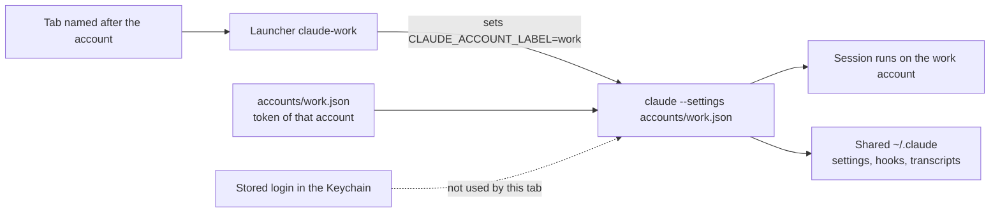
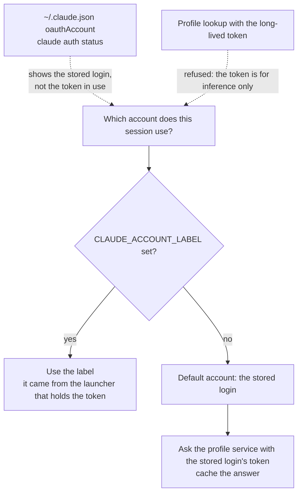
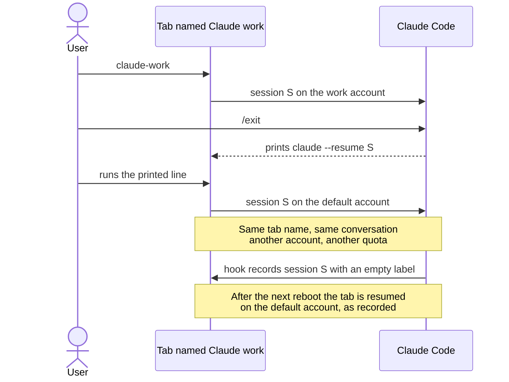
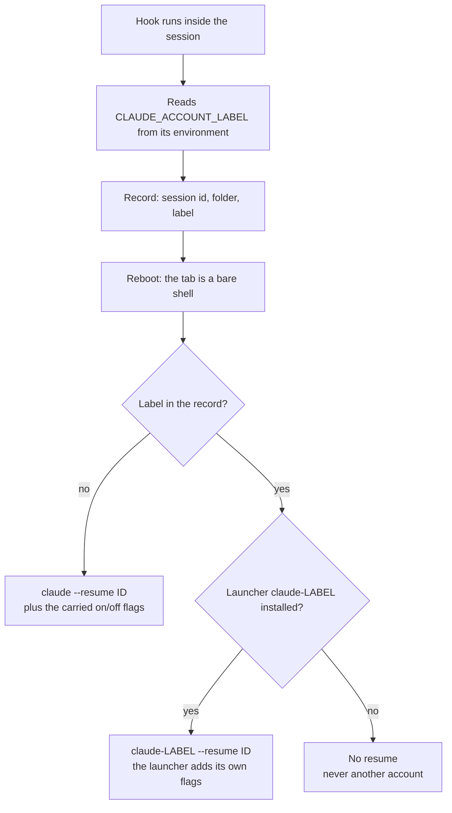

# One Claude Code account per tab

[Guide](../README.en.md)

Several Claude Code accounts on one machine, each tab on its own account, all at the same time. This page describes the setup the rest of the guide assumes when it says "account launcher", and what went wrong around it. Seen with Claude Code 2.1.326 and 2.1.327 on macOS.

## The idea

The normal sign-in (`/login`) stores one login for the machine user. On macOS it is one Keychain item. One stored login cannot give two tabs two accounts at the same time.

A long-lived token per account can. Each account gets a small settings file that holds only its token, and a launcher that starts Claude Code with that file:



Everything except the sign-in stays shared: one `~/.claude` with one set of settings, hooks, plugins and transcripts. That is the point of the design, and also the source of the main trap below.

## Setup

1. **A token per account.** Run `claude setup-token` and sign in as the account the token is for. The command's own help calls the result a "long-lived authentication token" and it needs a Claude subscription. Repeat per account.
2. **A settings file per account**, for example `~/.claude/accounts/work.json`, with nothing but the token:

   ```json
   { "env": { "CLAUDE_CODE_OAUTH_TOKEN": "<the token>" } }
   ```

   File mode 0600, folder mode 0700. An example with a placeholder is in [`examples/claude-account-settings.json`](../examples/claude-account-settings.json).
3. **A launcher per account**, `~/.local/bin/claude-<label>`, see [`examples/claude-account-launcher.sh`](../examples/claude-account-launcher.sh). It exports `CLAUDE_ACCOUNT_LABEL` and runs `claude --settings <that file> "$@"`. Flags you always want for that account go into the launcher.
4. **Start every session of that account through its launcher**: `claude-work`, `claude-work --resume <id>`, `claude-work -w <name>`. A menu entry per account helps, see [custom menu entries](custom-menu-entries.md).

The label must be 1 to 32 characters of letters, digits, `_` and `-`. The resume tool drops any other label and treats the session as the default account.

The default account is the stored login: plain `claude`, no label, no settings file.

## Why a settings file

| Way to pass the token | Problem |
|---|---|
| `export CLAUDE_CODE_OAUTH_TOKEN=...` in a shell startup file | Every program started from that shell inherits the token, and one shell can only hold one account |
| `--settings '<json string>'` on the command line | `--settings` accepts a JSON string too, but then the token is part of the command line and shows in `ps` for every user of the machine |
| `--settings <file>` | The command line shows only a path. The file is readable by you alone |
| A separate config folder per account | Not used here. It would split settings, hooks and transcripts per account, and the resume tool reads one shared session store |

Observed in a session started through a launcher (2.1.327): a command run by the agent did not see the token variable in its environment, and neither did the status line command. `CLAUDE_ACCOUNT_LABEL` was visible to both. Hooks were not checked.

## Which account is this tab on?

With several accounts this question has no reliable answer from Claude Code's own files:



What was seen:

- `~/.claude.json` (`oauthAccount`) and `claude auth status` describe the stored login. In a launcher tab they name the wrong account.
- The desktop app's built-in Claude Code shares `~/.claude.json` and overwrites `oauthAccount` with the desktop app's account. So that field can be wrong even for the default account.
- The long-lived token cannot be used to look the account up: the profile request was refused (403). The token only does inference.
- The quota numbers in the status line payload (`rate_limits`) belong to the session's own account. They were always right.

So the label is exported by the launcher, and everything that needs the account reads the label: the status line, the resume tool, the menu entries. A status line script needs one line for it:

```sh
if [ -n "$CLAUDE_ACCOUNT_LABEL" ]; then printf '%s' "$CLAUDE_ACCOUNT_LABEL"; else lookup_stored_login; fi
```

Two more things from the default account's lookup on macOS:

- The login Keychain had two items of the service `Claude Code-credentials`: the real one (account = the user name) and an empty one with account "unknown" whose origin was never found. A lookup by service alone returned the empty one. Ask for the item with your user name first.
- The stored token changes every few hours. A status line that looks the name up should keep the last known name while it asks again, or the name blinks out.

## The trap: one session, any account

Transcripts are shared, so any account can continue any session. Nothing warns you.



The line Claude Code prints at exit is `claude --resume <id>`. With launchers the right form is `claude-<label> --resume <id>`. The same slip happens when a tab has lost its agent and you type plain `claude` out of habit, see [shell pitfalls](shell-pitfalls.md).

How to notice: the status line shows the label, or the stored login's name when there is no label. In the resume tool, `hc-claude-resume list` shows the recorded account of each tab.

## Accounts and the resume tool



- The record holds the label, never the token and never the settings file's path.
- `hc-claude-resume seed` records sessions that were already running. It reads the label from the running process's environment, that one variable only.
- A session keeps the account it really ran as. The tab's name plays no role.
- Removing a launcher turns the resume off for that account's tabs. The tab stays a shell and the log is silent about it: check `command -v claude-<label>`.

See [resume after a reboot](resume-after-reboot.md).

## Launcher tabs and the Keychain

A launcher tab does not need the Keychain to sign in. That showed when the core was born in an ssh session and nothing in its tabs could read the Keychain: default-account tabs said "Not logged in", launcher tabs worked. See [core environment](core-environment.md).

It also hid the problem for a while. When some tabs are signed out and others are fine, compare how they sign in before you suspect the accounts.

## Quota windows

The status line payload reports a 5-hour window and a weekly window when the account has them.

- A normal account stops reporting the 5-hour window once its reset time has passed, until the next use. A missing 5-hour window does not mean the account has none.
- A plan with only a weekly limit would report the weekly window and never the 5-hour one. None of the accounts here was such a plan. The status line's handling of that case (remember per session whether a 5-hour window was ever reported) was tested with edited payloads only.
- A quota display that keeps the previous numbers when a window is missing can show another account's numbers. Key any such cache by session, not by machine.

## Keeping the tokens safe

- The settings files are credentials. Keep the folder out of dotfile repositories, shared backups and synced folders.
- Never paste a settings file, a launcher with an inline token or the output of `ps eww` into an issue or a chat. `ps eww` prints the environment of processes.
- Scripts that need to know the account should take the label. Nothing in this repository reads a token.
- When a token may have leaked, replace it: create a new one, put it into the settings file, restart that account's tabs.

## Not tested

- How long such a token stays valid, and what a tab shows when it expires.
- Linux and Windows. On Linux the stored login is a file, not a Keychain item.
- Accounts that sign in with an API key or through a cloud provider.
