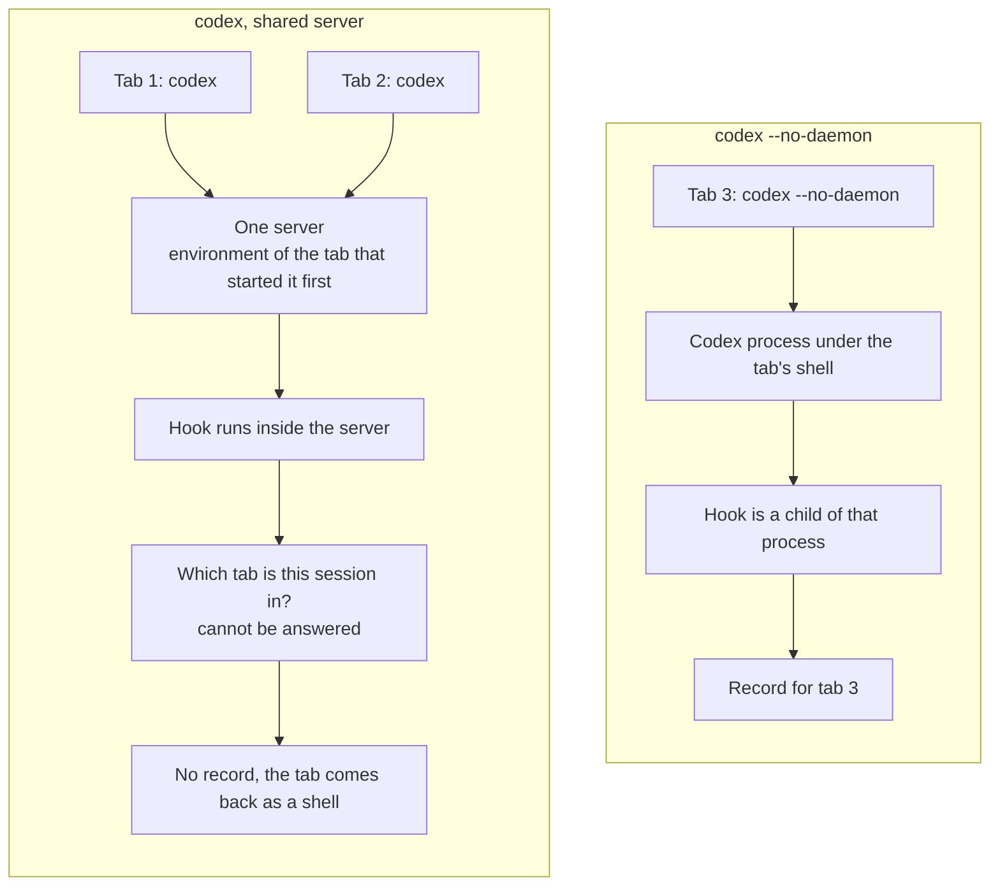
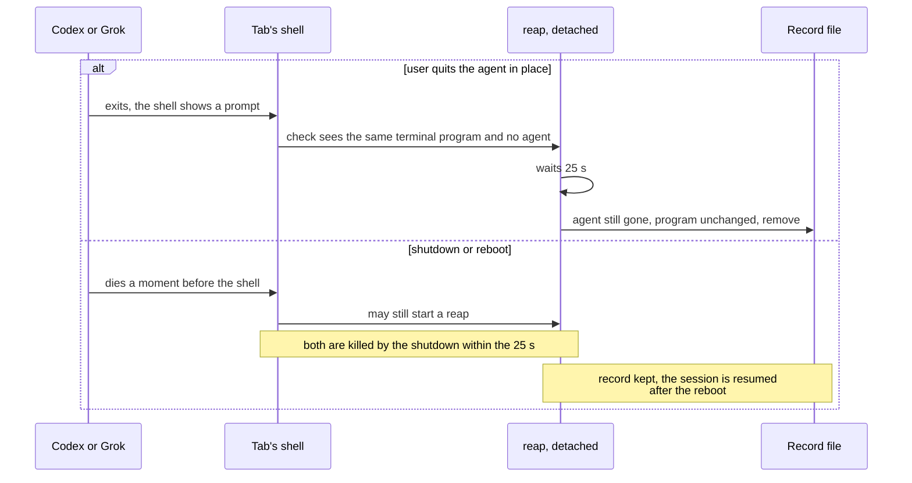
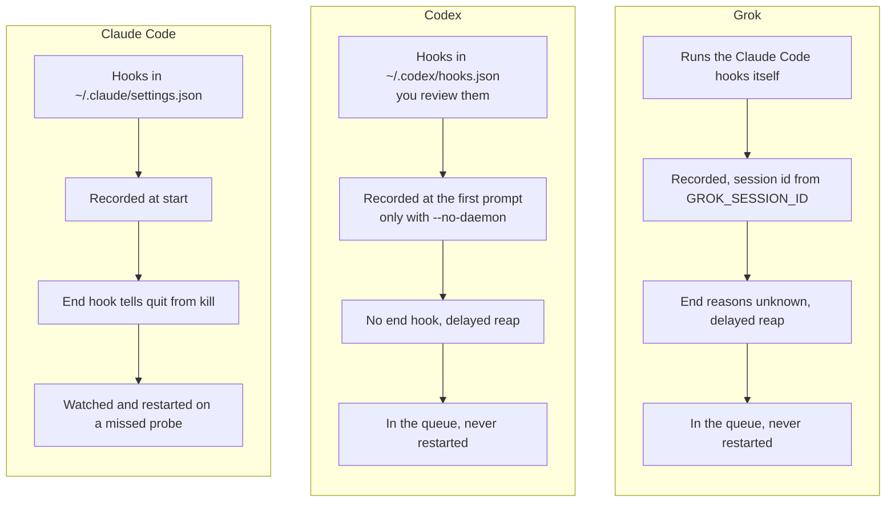

# Codex and Grok

[Guide](../README.en.md)

The resume tool was written for Claude Code first. Codex and Grok were added later, and each one behaves differently enough to need its own notes. Versions seen: codex-cli 0.169.1, grok 1.0.88.

## Codex

### Hooks must be reviewed by you

Codex reads hooks from `~/.codex/hooks.json` ([example](../examples/codex-hooks.json)). When a hook is new or its command changed, Codex shows a "Hooks need review" prompt at the next start. Until you accept, the hook does not run and nothing is recorded.

That prompt is a safety check and it is yours to answer. If you let an agent install the hooks for you, the agent should stop there and tell you; it should not press the key for you.

### The shared background server hides the terminal

Codex 0.169 can run its sessions inside one shared background server. A session started as plain `codex` then runs its hooks inside that server, and the server has the environment of the terminal that started it first. The hook looks for `HC_TERMINAL_ID` and its parent processes to learn which tab it belongs to, finds the wrong tab or none, and records nothing. That is the correct outcome of an unanswerable question, but it means:

- A tab started with plain `codex` is not recorded and comes back as a shell after a reboot.
- A tab started with `codex --no-daemon` is recorded normally. The Herdr app's own Codex menu entry starts it that way.
- `--no-daemon` is one of the flags carried over to the resume command, so a resumed session stays recordable.



If you type `codex` by hand in a tab and want it back after a reboot, type `codex --no-daemon`, or make that an alias.

### No end hook

Codex fires SessionStart at the first prompt, not at start, and has no SessionEnd. So:

- A Codex tab where nothing was typed yet has no record.
- Quitting Codex cannot remove the record directly. Instead, when a shell shows its first prompt in a terminal whose record says "an agent was here", and the terminal's program is still the same one, the agent was quit in place. A detached `reap` then removes the record 25 s later, if the agent is still gone and the terminal's program is still unchanged.
- The delay matters at shutdown: the agent can die a moment before its shell does. Without the delay, a reboot would look like the user quitting, and the record would be gone exactly when it is needed.



### Sessions started by another Codex session

A review or subagent started by Codex inherits the parent's thread id in `CODEX_THREAD_ID`. The hook skips a session whose own id differs from the inherited one, and it skips one-shot subcommands (`exec`, `review`, `login` and the rest of `CODEX_HEADLESS` in the script).

### Resume

```
codex resume [carried flags] <session-id>
```

## Grok

- Grok runs the hooks of `~/.claude/settings.json` itself. Nothing was added to any Grok file.
- Because both agents run the same hook line, the hook tells them apart by the nearest parent process that is an agent, and takes the session id from `GROK_SESSION_ID` when the payload has none.
- Grok's end reasons were not found documented, so its records are removed the same way as Codex records: by the delayed `reap`.
- One-shot runs (`-p`, `--single`, `--prompt-file`, `--prompt-json`) are not recorded.
- Resume: `grok [carried flags] --resume <session-id>`.

The three agents side by side:



## Bringing back a tab that was already lost

A tab that was a bare shell before the hooks existed, or a plain `codex` tab after a reboot, has no record. If you know which session it had:

```
hc-claude-resume set <terminal> <claude|codex|grok> <session-id> [folder]
```

It refuses when an agent is running in that terminal. The record has program pid 0, which never matches a real program, so the next shell that starts in the terminal resumes the session.

Finding the session id is the hard part. What worked: match the tab's creation time and folder against the creation time and folder of the sessions in the agent's own session store, then check the first lines of the conversation before you trust the match. Session stores are private data; read them on your own machine and do not paste them anywhere.

## Status reports

The missed status probe described in [root cause](missing-agents-root-cause.md) was only seen with Claude Code. The watcher restarts only Claude Code tabs. Codex and Grok tabs take part in the start queue but are never restarted.
