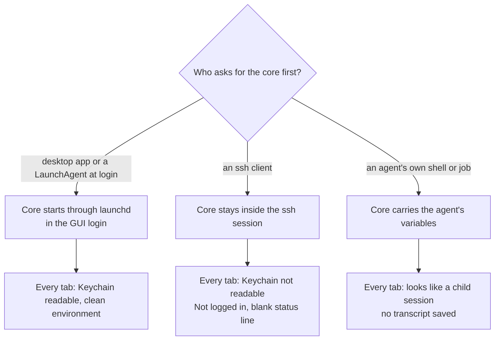
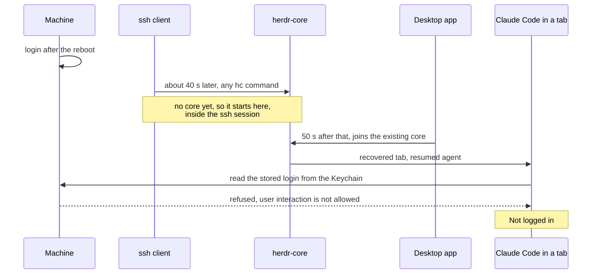
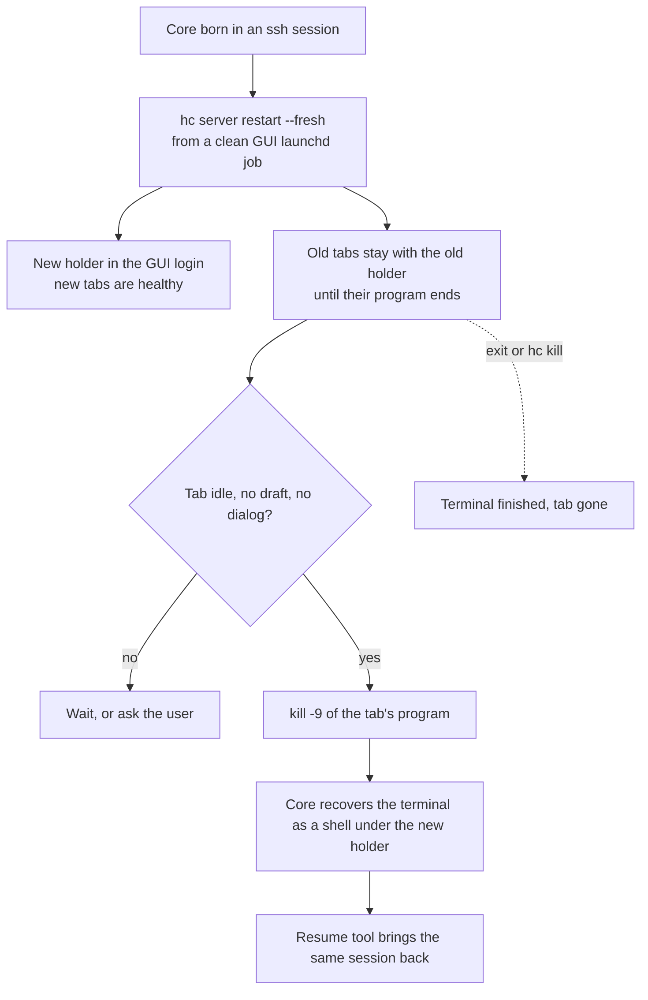
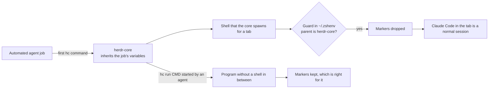

# The core's environment decides what every tab can do

[Guide](../README.en.md)

herdr-core starts on demand, in the session of whoever asks first. Any `hc` or `herdr-core` command starts it, even `hc server status`. The core then hands its own environment and login context to every terminal it creates. Two problems came from that, and both looked like bugs somewhere else.



## Case 1: the core was born in an ssh session (macOS)

### Symptom

After a reboot, tabs with the default Claude Code account said "Not logged in - Run /login". The status line had no account and no quota. Tabs started through an account launcher (sign-in from a settings file, see [one account per tab](claude-accounts.md)) were fine.

### Cause

On macOS a start from the desktop goes through a one-shot launchd job in the GUI login. A start that has `SSH_CONNECTION`, `SSH_CLIENT` or `SSH_TTY` in its environment stays a direct child of the ssh session. In that process tree nothing can read the login Keychain:

```
security find-generic-password -s "Claude Code-credentials" -w
# exit code 36: User interaction is not allowed
```

On the day it happened a tablet connected over ssh about 40 seconds after login and asked the core for its tabs. The desktop app started 50 seconds later and joined the core that already existed.



### How to check

```
ps -axo pid,ppid,command | grep -E "herdr-core serve|hc-launchd"
```

A `herdr-core serve` whose parent is an ssh session process is ssh-born. A healthy start shows the launchd helper with parent 1. Then run the `security` line above in a tab: exit code 0 is healthy, 36 is the problem.

### Repair without losing the tabs

1. Run `hc server restart --fresh` from a clean GUI context, for example a one-shot launchd job bootstrapped into `gui/$(id -u)`. Do not run it from an agent's shell: `--fresh` copies the caller's environment into every new terminal (that is case 2). A plain `hc server restart` keeps the environment the core started with, so it repairs nothing.
2. New terminals now live in the GUI login. Existing terminals stay with the old holder (`current: false` in `hc server status`) until their program ends.
3. Move an existing tab over by killing its program: `kill -9 <pid>` with the pid from `hc get <terminal> --json`. The core recovers the terminal as a login shell under the new holder, with scrollback and folder, and the [resume tool](resume-after-reboot.md) brings the agent back. The agent inside only gets a hangup, which keeps its record.



Never use `exit` or `hc kill` for step 3. Both leave the terminal finished and the tab is gone. This was tested in a separate core after an earlier, wrong piece of advice.

Before killing a tab's program, check: the agent is idle, no draft in the input box, no open question or dialog, no other program running under a bare shell.

### Prevention

- [`examples/herdr-core-start.plist`](../examples/herdr-core-start.plist): a LaunchAgent that runs `hc server status` at login, so the core already exists in the GUI login before any ssh client arrives.
- [`shell/zshenv-ssh-core-guard.zsh`](../shell/zshenv-ssh-core-guard.zsh): when an ssh command names `hc` or `herdr-core`, first start the core without the ssh markers. A no-op when a core runs.

Both together, because the LaunchAgent alone does not help after the core was stopped by hand.

## Case 2: the core was started by an agent (seen on Linux)

### Symptom

In a normal tab Claude Code printed a banner like "Transcript saving is off - inherited CLAUDE_CODE_CHILD_SESSION marker". No session file, no transcript, so the session could not be resumed later. Auto memory and background tasks were off as well.

### Cause

The core had been auto-started by an automated Claude Code job. It carried that job's variables (`CLAUDECODE`, `CLAUDE_CODE_CHILD_SESSION`, `CLAUDE_CODE_ENTRYPOINT`, `GIT_EDITOR=true` and more) and passed them to every tab. Claude Code in such a tab believes it is a child session of another agent.

### How to check

Look at the variable names in the core's environment before touching anything else:

```
tr '\0' '\n' < /proc/<herdr-core pid>/environ | cut -d= -f1 | grep -i claude    # Linux
ps eww -p <herdr-core pid>                                                       # macOS
```

The values can hold secrets. Print names only, and do not paste the output anywhere.

### Fix

- Clean: restart the core from a shell without those variables. That ends when the job auto-starts the core again.
- Durable: [`shell/zshenv-leaked-env-guard.zsh`](../shell/zshenv-leaked-env-guard.zsh) drops the markers, but only in the shell that herdr-core itself spawned (parent process is `herdr-core`). Programs that an agent starts directly with `hc run <cmd>` do not pass through that shell and keep their markers, which is right for them.



Sessions that already ran with the marker must be restarted to save transcripts. What they said before that is not on disk.

## A core for experiments

`HC_SESSION=<name> hc ...` talks to a separate core with its own terminals and its own state folder `~/.local/state/herdr-core/<name>/`. Everything in [reproduce](reproduce.md) runs there. Start it with a clean environment (`env -i` with only what is needed), for the reason in case 2. Stop it with `HC_SESSION=<name> hc server stop` and remove its state folder when done.

## Rule of thumb

When agents in tabs behave as if they were signed out, sandboxed or somebody's child, look at who started the core and with which environment before you debug the agent, the status line or the resume tool.
