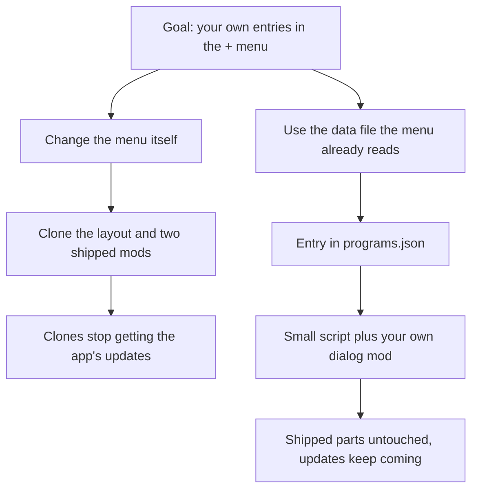
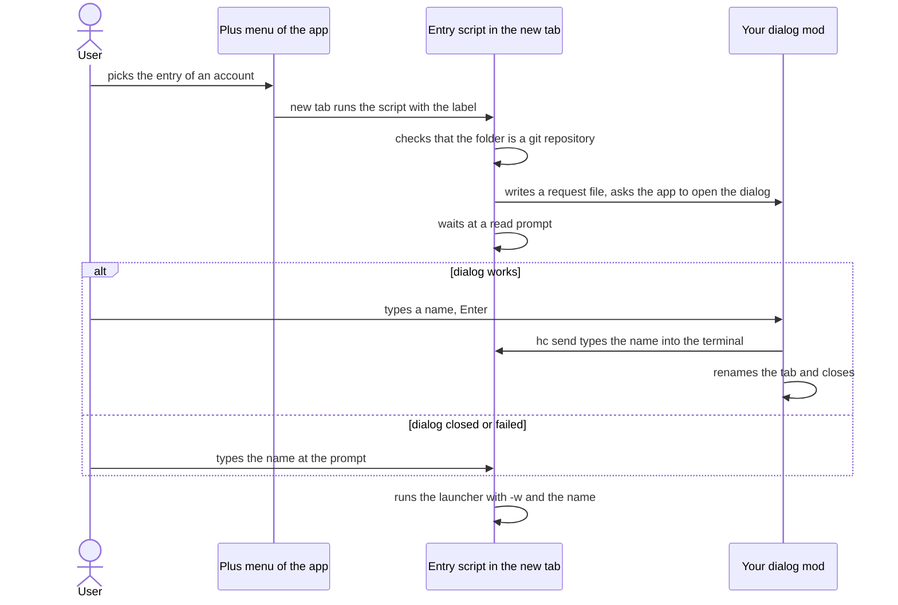

# Adding your own entries to the Herdr app's + menu

[Guide](../README.en.md)

Goal: a menu entry per Claude Code account that asks for a name and starts `claude-<label> -w <name>` (Claude Code's own worktree flag) in a new tab.

This page describes the approach only. The files are small and specific to one setup, so they are not in this repository.

## The trap

The + button lives in a mod that ships with the app, and it opens another shipped mod. Shipped mods are replaced on every start of the app. Changing the menu itself therefore means cloning the layout and both mods, and clones stop getting the app's updates.

## What worked without cloning anything

The + menu lists whatever `~/.config/herdr-app/programs.json` has a `run` command for. So:

1. **An entry in `programs.json`** per account, with `run: ["<script>", "<label>"]`. Back the file up before editing.
2. **A small script** as the entry's program. It checks that the folder is a git repository, writes a request file (terminal id, account label, time) into its own state folder, asks the app to open a dialog (`herdr-app do mod.open:<your mod>`), and then waits at a plain `read` prompt in the terminal.
3. **Your own dialog mod** in `~/.config/herdr-app/mods/<your mod>/`. It reads the request file. On Enter it types the name into that terminal (`hc send <terminal> <name>`), renames the tab and closes.

The script receives the name on its `read` prompt either from the dialog or from the keyboard, and then runs the launcher. The dialog is a convenience, not a dependency: when it fails, the prompt in the terminal still works.

## Things to know

- `mod.open` toggles. Two requests at the same moment close the dialog again. The terminal prompt still works.
- `claude -w` refuses in a folder whose trust dialog was never accepted.
- Entries exist only on the machine that has the script. On a remote space the app shows them as not installed.
- A new account needs only a new `programs.json` entry. The script and the mod take the label as data.
- A session started this way is recorded by the [resume tool](resume-after-reboot.md) like any other, with the account label of the launcher. The launchers themselves are described in [one account per tab](claude-accounts.md).

## The general lesson

Before cloning a shipped component to change it, look for a data file the component already reads. An entry plus a script that calls back into the app gave the same result and keeps every future update.
