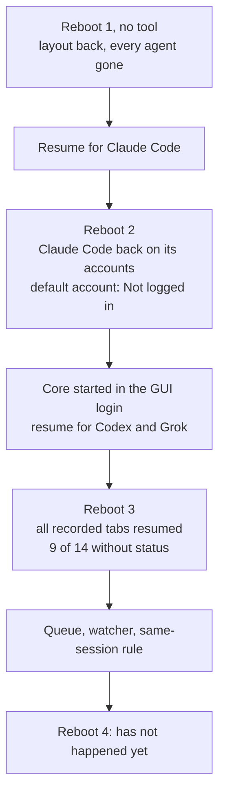
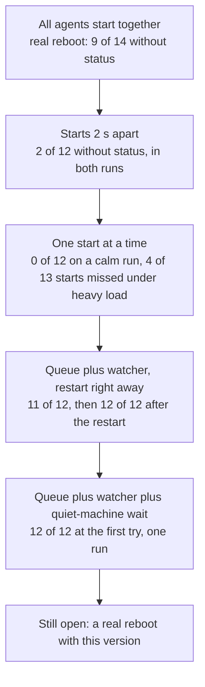
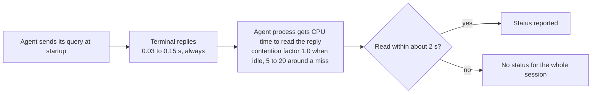

# Observed results

[Guide](../README.en.md)

Everything here was seen on one machine by one person between 2026-11-12 and 2026-11-18. The raw logs are private and are not in this repository, so these tables are a summary you cannot audit. Use [reproduce](reproduce.md) to get your own numbers.

## Setup

| Item | Value |
|---|---|
| Machine | Laptop, 14 CPU cores, macOS 27.0.1 |
| Multiplexer | herdr-core (`hc` 0.1.21) with the Herdr app |
| Agents | Claude Code 2.1.326 and 2.1.327, codex-cli 0.169.1, grok 1.0.88 |
| Shell | zsh 5.9. The tool ran on Python 3.14; it also parses on 3.9 |
| Test folder | One folder with about 184,000 files. Each session's file index at start is the main CPU load |
| Test sessions | Copies of real transcripts under new ids, started idle, no prompt sent |

## Real reboots

| Date | Tool version | What came back | What did not |
|---|---|---|---|
| 2026-11-12 | None | Layout, tab names, folders, scrollback | Every agent: tabs were plain shells. A manual restart in a tab used the default account, not the tab's account |
| 2026-11-16 | Resume for Claude Code | Claude Code tabs, each with its recorded account | Codex and Grok tabs (not covered yet). Default-account tabs said "Not logged in": the core was born in an ssh session, see [core environment](core-environment.md) |
| 2026-11-18 | Resume for all three agents, no queue | All recorded tabs resumed | 9 of 14 Claude Code tabs had no status and were missing from the Agents list. About 30 agents started in the same seconds. One session opened in two tabs |

The queue, the watcher and the same-session rule were written after the third reboot. **They have not been through a real reboot yet.**

## Simulated reboots, 12 sessions

Separate core, all shells lost at once, see [reproduce](reproduce.md). "With status" counts Claude Code tabs that reported a status.

| Variant | Runs | With status | Notes |
|---|---|---|---|
| Starts 2 s apart, nothing else | 2 | 10 of 12, both runs | The first "fix". Wrong |
| One start at a time, waiting for the previous status | 1 | 12 of 12 | 1 minute load average 134 |
| Same, heavier load | 1 | 4 of 13 starts missed | Load average 187. One session missed twice in a row |
| Same, 6 sessions | 1 | 6 of 6 | |
| Queue + watcher, restart right away | 1 | 11 of 12, then 12 of 12 | The missed tab was restarted and had a status about 90 s after the core start |
| Queue + watcher + quiet-machine wait (current) | 1 | 12 of 12 at the first try | Nothing to repair in this run |
| Current, published tools, 4 sessions | 1 | 4 of 4 | Slowest terminal reply 36 ms |

One run per variant is thin. The numbers show that spacing alone fails; they do not show a failure rate.

The same attempts in the order they were made:

## Where the time goes

| Measurement | Result |
|---|---|
| Terminal's reply to `OSC 7501 ; ?`, asked twice a second during a 12 session start | 0.03 to 0.15 s, no reply missing |
| Contention factor (wall time over CPU time of a 50 ms busy loop), idle machine | 1.0 |
| Same, in the seconds around a missed probe | 5 to 20 |
| Time for one agent to come up when about 30 start together | 5 to 20 s |
| Time until 12 tabs are all resumed through the queue, calm machine | About 35 s |

Load average did not line up with the misses. It moves too slowly to show a burst of a few seconds; the busy loop does.

## Forced misses

With the test switch that makes a session report no status ([reproduce](reproduce.md)):

| Case | Result |
|---|---|
| Misses once | Restarted once, then reported a status |
| Misses always | Restarted twice, then `giving up`, no third restart |
| Two records for one session, both tabs lost | Only the later record's tab ran the agent |
| Two records for one session, the old tab's shell not lost | The old tab stayed a shell |
| Off switch `no-status-retry` present | Miss logged, no restart |

A bug found by this test: the first version of the retry counter emptied its file before reading it, so the count never passed 1 and a tab that always missed was restarted past the limit of 2. The counter is now read before the file is opened for writing.

## Not tested

- A real reboot with the current version.
- Linux, bash, fish, other terminals or multiplexers.
- Other versions of the agents. The 2 s deadline and the single probe can change in any release.
- Fresh sessions that miss their probe (the watcher only follows resumed tabs).
- Long sessions that lose their status later for another reason. One such tab was seen on another machine and not investigated.
- More than 14 Claude Code tabs, or machines with fewer cores.
- A user typing in a tab at the moment the watcher decides to restart it. The screen is read again on every look (3 s apart) up to the restart, and anything but an empty input box resets the wait, but the fraction of a second between the last look and the kill was not tested with a person at the keyboard.
