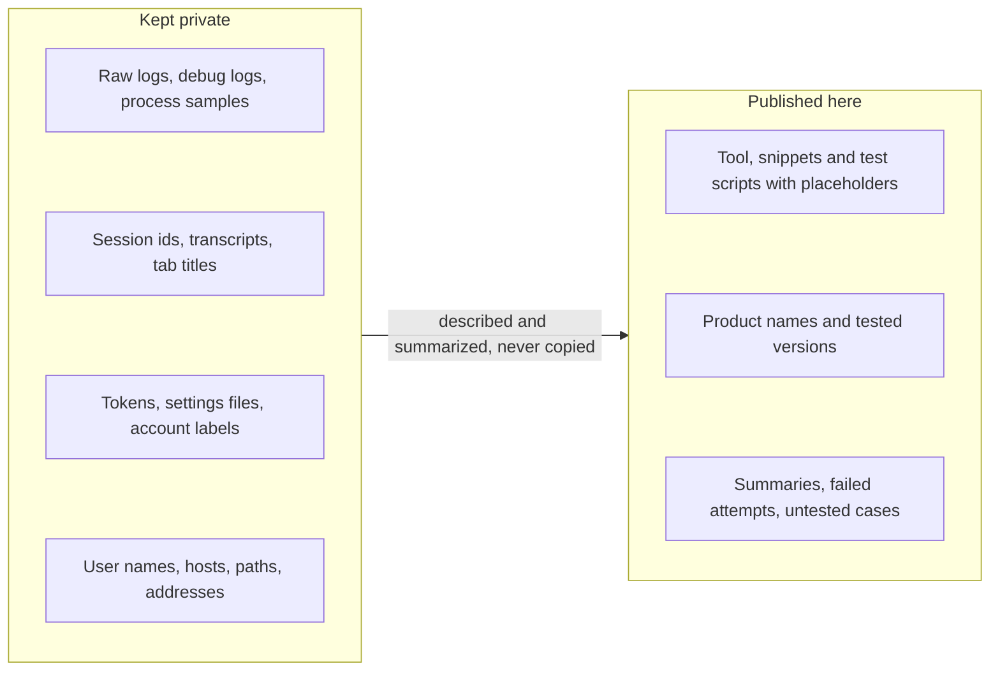
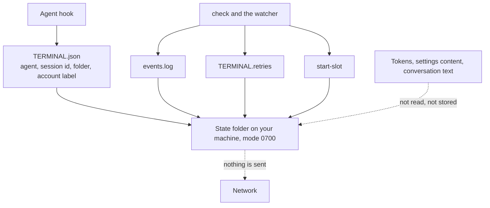

# What is published here, and what you should keep private

[Guide](../README.en.md)

The work behind this guide was done on private machines with private accounts and sessions. The repository describes techniques and outcomes. It is not a copy of that setup.

## Included

- The resume tool, shell snippets and test tools, with every personal value replaced by a placeholder or an example label (`work`, `probe`, `__HOME__`, `<terminal>`, `<session id>`).
- Product names and the versions that were tested.
- Summaries of what was measured, with the failed attempts and the untested cases left in.

## Left out on purpose

- User names, home folder paths, host names, ssh aliases, IP addresses and device names.
- Account labels, settings files with sign-in data, tokens and any credential.
- Session ids, terminal ids, transcripts, conversation text and tab titles.
- Project and folder names.
- Raw logs: `events.log`, agent debug logs, process samples, reply timings.
- Code or internal identifiers taken out of any agent's shipped client. Behavior is described as it was observed from outside and in the debug log.

## What the resume tool stores on your machine

In `~/.local/state/hc-claude-resume/<core>/`:

| File | Content |
|---|---|
| `<terminal>.json` | Agent, session id, folder, account label, carried flags, two pids, time |
| `<terminal>.retries` | A count and a time |
| `start-slot` | Terminal and time of the last start |
| `events.log` | One line per event, with terminal, session id and reason |

No token, no settings content and no conversation text is stored or read. The tool sends nothing over the network. The folder is created with mode 0700.

Still, session ids together with folder paths say what you work on. Treat that folder as private.

## Before you share your own findings

1. Read every file you are about to publish. An ignore file is a convenience, not a scanner.
2. Search for your user name, home path, host names, account labels and session ids, not only for tokens.
3. An agent's debug log is not safe to paste whole. Take the one line you need.
4. A process list (`ps`, the CPU sampler here) holds command lines of everything running, sometimes with secrets in arguments.
5. Copies of transcripts made for tests are as private as the originals. Delete them when the test is done.
6. Printing the environment of a process prints its secrets. Print variable names only.
7. If a credential did get into a commit, treat it as leaked: revoke it. Removing the file later does not undo the publication.

The tests of this repository check a few patterns (home folder paths, IP and email addresses, bearer tokens and API keys, session-id shaped strings). They catch slips; they do not replace reading.
