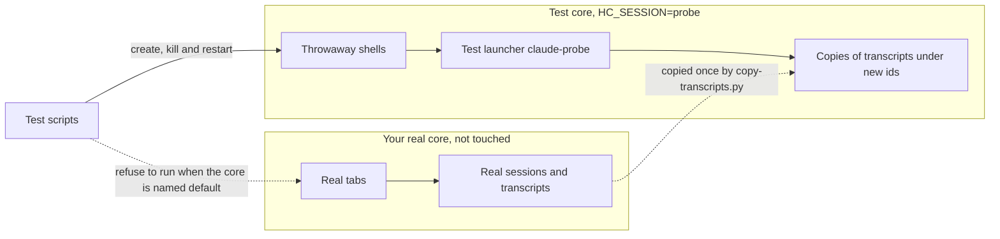
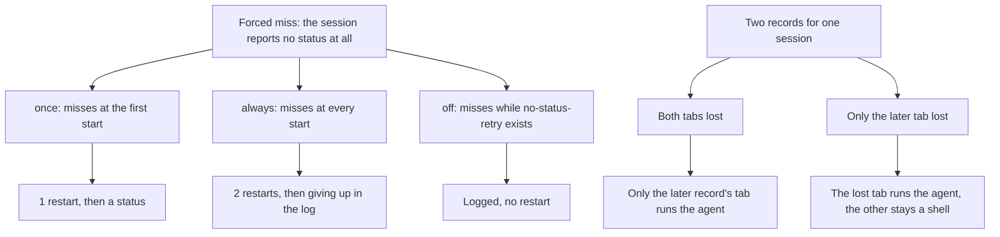
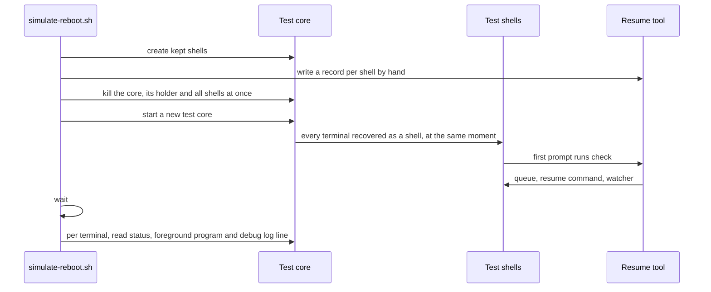

# Reproducing the reboot, safely

[Guide](../README.en.md)

A real reboot is a slow and expensive test, and it puts your real sessions at risk. Everything here runs in a separate herdr-core with throwaway copies of sessions. Your real tabs are not touched.

Read the scripts before you run them. They kill processes with `kill -9`, and they refuse to run when they cannot tell the test core from the real one.



## What you need

- macOS, zsh, `hc`, `jq`, Python 3.
- The resume tool installed as in [resume after a reboot](resume-after-reboot.md): the script in `~/.local/bin/`, the Claude Code hooks, the `~/.zshrc` trigger. The test shells are login shells and use the same trigger as your real tabs.
- A folder to run the test sessions in, whose Claude Code trust dialog was already accepted, and a few Claude Code transcripts that belong to that folder. A session that stops at a dialog never reaches its prompt, and the watcher leaves it alone.

The test sessions only start and sit at their prompt. No prompt is sent to any model.

## Setup

```sh
# 1. The test launcher. The label "probe" is the default of the scripts.
cp tools/claude-probe-launcher.sh ~/.local/bin/claude-probe
chmod +x ~/.local/bin/claude-probe

# 2. Throwaway copies of transcripts. A resumed session appends to its transcript,
#    so never test with a real session id.
tools/copy-transcripts.py ~/.claude/projects/<project folder>/<session id>.jsonl [more ...]

# 3. Run the tests from the folder those sessions belong to.
cd <that folder>
```

Environment variables, all optional, see [`tools/probe-env.zsh`](../tools/probe-env.zsh):

| Variable | Default | Meaning |
|---|---|---|
| `PROBE_CORE` | `probe` | Name of the separate core. `default` is refused |
| `PROBE_BASE` | `$TMPDIR/hc-probe` | Folder for the logs of the runs |
| `PROBE_LABEL` | `probe` | Label of the test launcher (`claude-<label>`) |
| `PROBE_WORK_DIR` | current folder | Folder the test sessions run in |
| `PROBE_SETTINGS` | none | Settings file passed to `claude --settings`, when the test needs a specific account |

## Functional test: forced misses

Needs 5 copies. Takes about 5 minutes.

```sh
<repo>/tools/functional-test.sh f1
```

The launcher has a switch that makes a session report no status at all (`CLAUDE_CODE_DISABLE_TERMINAL_TITLE=1`). That gives the same symptom as a missed probe, on demand and without loading the machine. Expected:

| Tab | Setup | Expected result |
|---|---|---|
| `once` | Misses at the first start | Restarted once, then has a status |
| `always` | Misses at every start | 2 restarts, then `giving up` in the log, and still no status |
| `dupold`, `dupnew` | Two records for one session, both tabs lost | Only `dupnew` runs the agent |
| `stale`, `moved` | Two records for one session, only `moved` was lost | `moved` runs the agent, `stale` stays a shell |
| `off` | Misses while `no-status-retry` exists | Logged, not restarted |

The quiet-machine wait applies here too, so a restart comes 30 s or more after the last start.



## Simulated reboot

```sh
<repo>/tools/simulate-reboot.sh b1 12            # 12 sessions
PINGER=1 WAIT=200 <repo>/tools/simulate-reboot.sh b2 12
```

What it does:

1. Creates kept shells in the test core and writes a resume record for each by hand.
2. Kills the test core, its holder and all those shells at once. For the core that is what a reboot looks like.
3. Starts a new test core. It recovers every terminal as a shell, all at the same moment, and each shell's first prompt runs the resume check.
4. Waits, then prints for each terminal its status, its foreground program and the "Terminal capabilities" line of its debug log.



With `PINGER=1` one more terminal asks `OSC 7501 ; ?` twice a second and logs how fast the core answers, to show which side is slow.

To see the raw problem, turn the repair off first (`touch ~/.local/state/hc-claude-resume/probe/no-status-retry`) and compare. To watch the CPU side, run [`tools/contention.py`](../tools/contention.py) next to it.

How hard the machine is hit depends on the folder: every session indexes its folder at start. A folder with very many files loads the machine far more than the number of sessions suggests. That is also what makes the problem show up, so a tiny folder may show no miss at all.

## Reading a run

In `$PROBE_BASE/<tag>/`:

- `result.txt`: one line per terminal. `"status":null` with `fg` = `claude` is a missed probe.
- `dbg-<terminal>.log`: the debug log of the last start in that terminal. Search for `Terminal capabilities`.
- `launch.log`: every start, with the forced-miss switch.
- `pinger.log`: reply times of the terminal.

In `~/.local/state/hc-claude-resume/<core>/events.log`: `start held`, `status check ... reports`, `restart try`, `giving up`.

## Cleanup

```sh
tools/copy-transcripts.py --clean                 # deletes exactly the copies it made
rm ~/.local/bin/claude-probe
HC_SESSION=probe hc server stop
rm -r ~/.local/state/herdr-core/probe ~/.local/state/hc-claude-resume/probe
```

Then check that only your real core is left: `ls ~/.local/state/herdr-core/`.

## Keep the outputs private

Debug logs, `events.log`, transcript copies and the output of [`tools/cpu-sample.sh`](../tools/cpu-sample.sh) contain session ids, folder paths, command lines and possibly conversation text. They are for your eyes. See [privacy](privacy.md).

## Limits of the method

- The simulation kills processes; it does not reboot. Login items, other apps starting, disk cache state and the network are all different after a real reboot.
- The load is produced by the test sessions themselves plus whatever else runs on the machine, so two runs are never equal. Count over several runs.
- A forced miss tests the repair path, not the cause.
