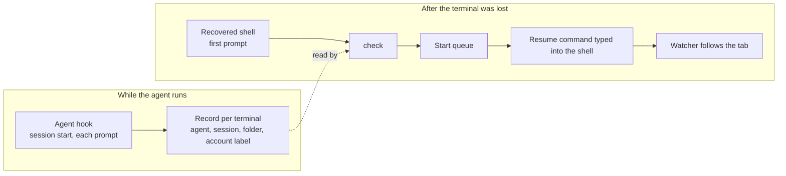
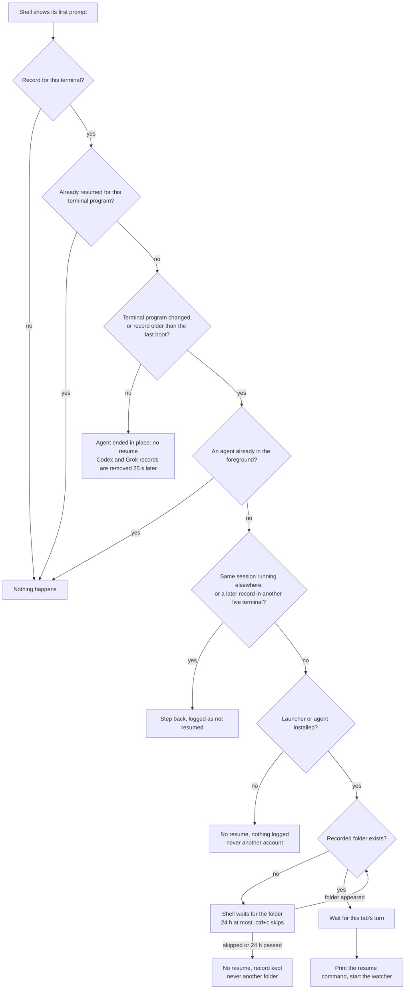
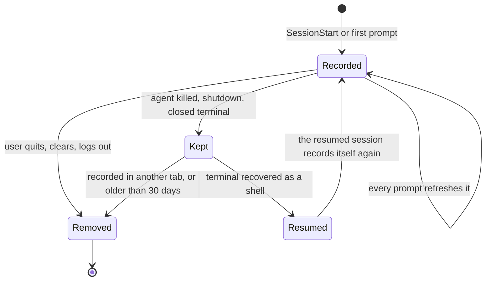
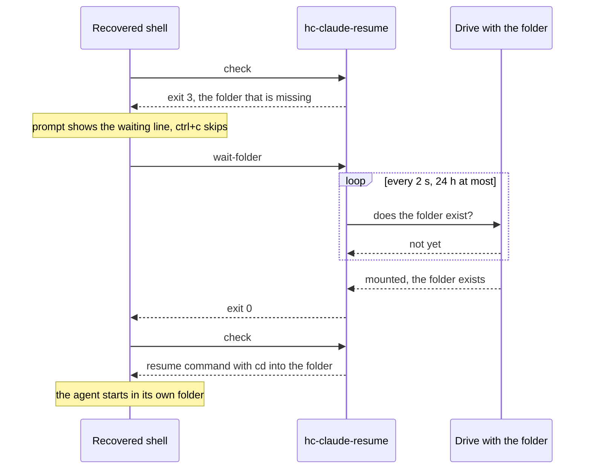
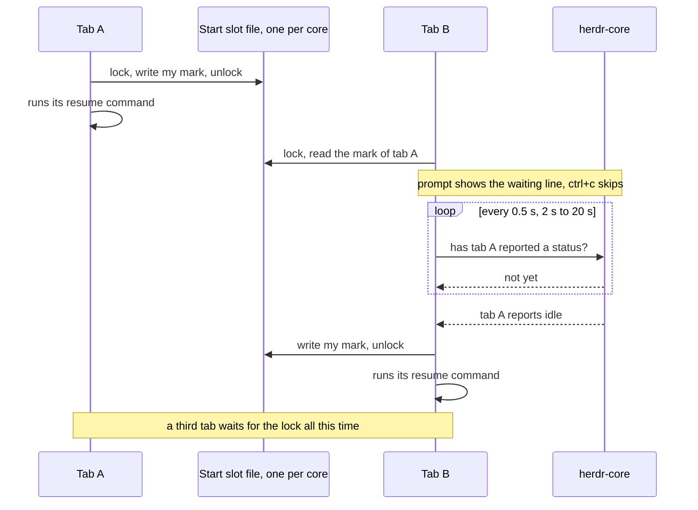
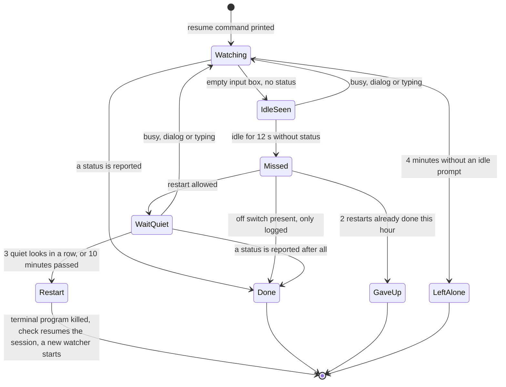

# Bringing agents back after a reboot

[Guide](../README.en.md)

## The gap

herdr-core keeps terminals across a reboot, a logout or a crash of the core. A lost terminal comes back with its name, folder and scrollback, but as a plain login shell. The command that ran there is not started again.

The tab is still called "Claude (work)" or "Codex", so the natural move is to type the agent's "continue" command. For Claude Code with several accounts that signs in with the default account, not the one the tab was using. The layout survives; the agents and their accounts do not.

[`bin/hc-claude-resume`](../bin/hc-claude-resume) closes that gap for Claude Code, Codex and Grok.

## How it works



1. **Record.** A hook of the agent writes one small JSON file per terminal: agent, session id, folder, account label, the agent's pid and the pid of the terminal's program. No tokens are stored.
2. **Detect the loss.** At the first prompt of a shell, `check` compares the record with the terminal. The agent is resumed only when the terminal's program changed since the record was written, or the record is older than the last boot. Both mean the terminal was lost and recovered.
3. **Resume.** `check` prints one command line and the shell runs it: `cd <folder> && claude-<label> --resume <id>`, `codex resume [flags] <id>` or `grok [flags] --resume <id>`. All three start in the recorded folder. When that folder does not exist, nothing is started: the tab waits for it, see [a folder that is not there yet](#a-folder-that-is-not-there-yet).

Things that deliberately do not resume: quitting the agent in place, a crash in place, a subshell, a second shell in the same terminal. In those cases the terminal's program is still the same one.

What `check` decides at the first prompt of a shell:



## Install

Tested on macOS with zsh. Requirements: `hc` in `PATH`, Python 3.9 or newer.

1. Copy `bin/hc-claude-resume` to `~/.local/bin/` and make it executable.
2. Claude Code: merge [`examples/claude-settings-hooks.json`](../examples/claude-settings-hooks.json) into `~/.claude/settings.json`. Keep the hooks you already have; back the file up first.
3. Codex: merge [`examples/codex-hooks.json`](../examples/codex-hooks.json) into `~/.codex/hooks.json` with `__HOME__` replaced, and make sure hooks are enabled in the Codex config. Codex asks you to review new hooks; until you accept, they do not run. See [Codex and Grok](codex-and-grok.md).
4. Grok: nothing to add. It runs the hooks of `~/.claude/settings.json` itself.
5. Paste [`shell/zshrc-resume-trigger.zsh`](../shell/zshrc-resume-trigger.zsh) into `~/.zshrc`.
6. Sessions that were already running do not pick up new hooks. Run `hc-claude-resume seed` once to record the running Claude Code sessions.
7. Several Claude accounts: use one launcher per account, see [one account per tab](claude-accounts.md) and [`examples/claude-account-launcher.sh`](../examples/claude-account-launcher.sh). The record stores the label and the resume uses the same launcher. A missing launcher means no resume; the tool never falls back to another account.

Check with `hc-claude-resume list` and the log `~/.local/state/hc-claude-resume/<core>/events.log`.

## Rules the record follows

| Situation | What happens | Why |
|---|---|---|
| SessionStart hook did not run (folder trust dialog not accepted yet) | UserPromptSubmit records the session at the first prompt | Claude Code skips SessionStart hooks before the trust dialog |
| `claude -p`, `codex exec` or a subagent started inside the tab | Not recorded | It inherits the terminal id; only the top agent of the terminal counts (the hook walks the parent processes) |
| A wrapper is the terminal's foreground program | Still recorded | The check walks parents instead of comparing with the foreground |
| User ends the Claude session on purpose (`/exit`, `/clear`, logout, resume of another session) | Record removed | SessionEnd reason says so |
| Agent killed (shutdown, closed pty, SIGTERM, SIGHUP) | Record kept | Those arrive as SessionEnd reason `other`, and a shutdown must not erase the record |
| Codex or Grok quit in place | Record removed about 25 s later | They have no usable end hook; a later shell notices the agent is gone while the terminal's program is unchanged. The delay keeps a shutdown from looking like a quit |
| Tab was a bare shell before the hook existed | `hc-claude-resume set <terminal> <agent> <session-id> [folder]` | Writes a record by hand; the next shell in that terminal resumes it |
| Record older than 30 days | Pruned | |

The life of a Claude Code record:



## One session, two tabs

A record survives when an agent dies in place. If the user then continues the same session in another tab, two records point at one session, and after the next reboot both tabs open it. This happened once.

Now:

- When a session is recorded for a terminal, records of the same session whose agent is not running are removed.
- At resume time, a terminal steps back when the same session runs elsewhere or another live terminal has a later record for it.

## A folder that is not there yet

A recorded folder can be missing when the tabs come back: an external drive that is not plugged in, a network share, or an encrypted volume that is only unlocked some time after login. On the fourth real reboot the tabs were back two minutes after login and the drive with their folders was mounted hours later.

The first versions of the tool dropped the `cd` when the folder was missing and started the agent anyway, in whatever folder the recovered shell had. That was wrong twice over:

- The agent worked in the wrong folder (the home folder), with the wrong project settings and files. Codex stopped at a question about which folder to use.
- The hook of the resumed agent then recorded that folder as the session's folder. After the next reboot the session would start in the wrong place again, with nothing left to show where it belonged.

Now a missing folder never leads to a start somewhere else:

1. `check` prints the folder and exits with code 3. The record is not marked as used.
2. The shell shows `hc-claude-resume: waiting for the session's folder <folder> (ctrl+c skips)` and runs `hc-claude-resume wait-folder`, which looks every 2 s for up to 24 hours.
3. When the folder exists, `check` runs again and the tab goes through the normal start queue.
4. After ctrl+c or 24 hours the tab is a normal shell with the line `agent not resumed, folder missing: <folder>`. The record is untouched. Once the folder is there, resume by hand in that tab:

```
eval "$(hc-claude-resume check)"
```



A missing account launcher still wins over a missing folder: without the launcher there is nothing to wait for, and the tab stays a shell.

If a session did start in the wrong folder (an older copy of the tool, or a resume typed by hand), the record now points there. Quit the agent, `cd` to the right folder and resume the session from there with the same launcher; the hook records the right folder again. For a tab you cannot type in, see [troubleshooting](troubleshooting.md).

## Starts take turns, and missed probes are repaired

After a reboot all shells reach their first prompt together. Starting all agents at once makes Claude Code lose its status probe, see [root cause](missing-agents-root-cause.md). So `check` does two more things.

**Queue.** One agent start at a time per core. The next start waits until the previous agent reports a status, 20 s at most per agent, 300 s at most in total. While a tab waits, its prompt shows `hc-claude-resume: waiting for this tab's turn to resume its agent (ctrl+c skips)`.



**Watcher.** For every resume a detached `status-check` process watches the tab:

- A status appears: done, logged as `reports <state> after Ns`.
- The tab shows Claude Code's empty input box for 12 s and still has no status: the probe was missed.
- The watcher then waits for a quiet machine: no agent start for 30 s and three looks in a row where a 50 ms busy loop takes less than 1.5x its CPU time. After 10 minutes it goes ahead anyway.
- It kills the terminal's program. The core recovers the terminal as a shell and `check` resumes the session again, through the same queue.
- At most 2 restarts per terminal per hour. Then: `giving up (restart the tab's program by hand)`.
- A tab that is busy, shows a dialog, or has text in the input box is left alone. After 4 minutes without an idle prompt the watcher stops.



Knobs, all constants at the top of the script:

| Constant | Default | Meaning |
|---|---|---|
| `START_GAP_S` | 2.0 | Least seconds between two starts |
| `START_SETTLE_MAX_S` | 20 | Longest wait for the previous agent's status |
| `START_WAIT_MAX_S` | 300 | Longest a start is held in total |
| `STATUS_IDLE_CONFIRM_S` | 12 | Idle prompt without status for this long means a miss |
| `STATUS_RETRY_MAX` | 2 | Restarts per terminal |
| `RESTART_QUIET_S` | 30 | No agent start for this long before a restart |
| `RESTART_CONTENTION_MAX` | 1.5 | Highest contention factor that counts as quiet |
| `RESTART_WAIT_MAX_S` | 600 | Longest wait for a quiet machine |
| `FOLDER_WAIT_MAX_S` | 86400 | Longest wait for a recorded folder that does not exist |
| `FOLDER_WAIT_EVERY_S` | 2 | Seconds between two looks for that folder |

Switches, empty files in `~/.local/state/hc-claude-resume/<core>/`:

- `no-status-retry`: the watcher only logs a miss and never restarts.
- `debug`: every hook call logs its process chain and payload keys.

## What you will notice

- Agent tabs come back one after another. Twelve tabs took about 35 s on a calm machine and longer under load. On a real reboot with 26 agent tabs the last one was held for 93 s.
- A tab whose folder is on a drive that is not mounted yet shows the waiting line and resumes by itself when the drive appears.
- A tab may restart itself once in the first minutes after a reboot. The session is the same; the scrollback above it stays.
- `events.log` tells the story of each tab: `start held`, `recorded`, `status check`, `not resumed`, `not resumed yet: ... folder missing`, `folder is back after Ns`.

## Limits

- macOS and zsh only were tested. On Linux the boot time lookup returns nothing, so only the "terminal program changed" rule applies.
- The idle check reads the screen for Claude Code's prompt character and the words "esc to interrupt". A redesign of that screen breaks the check; the watcher then does nothing, which is the safe side.
- The queue and the same-session rule went through one real reboot: 26 starts, every Claude Code tab reported a status, so the watcher had nothing to restart. The watcher's restart and the wait for a missing folder were only verified in a separate core. See [observed results](observed-results.md).
- The folder wait only knows "the folder exists". A folder that exists but is the wrong one (an old copy of a moved workspace, an empty mount point) is not noticed.
- The waiting shell holds its prompt. Typing in that tab needs ctrl+c first.
- Only a short list of on/off flags is carried over to the resume command (`RESUME_FLAGS` in the script), never a flag that takes a value. With an account launcher no flag is carried over: the launcher adds its own.
