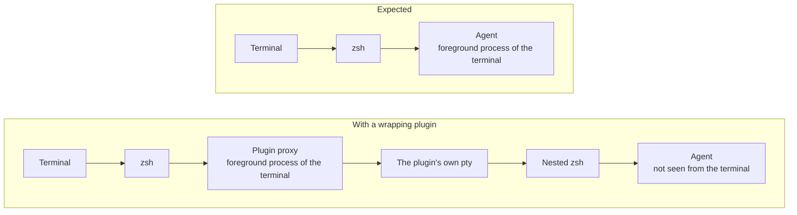
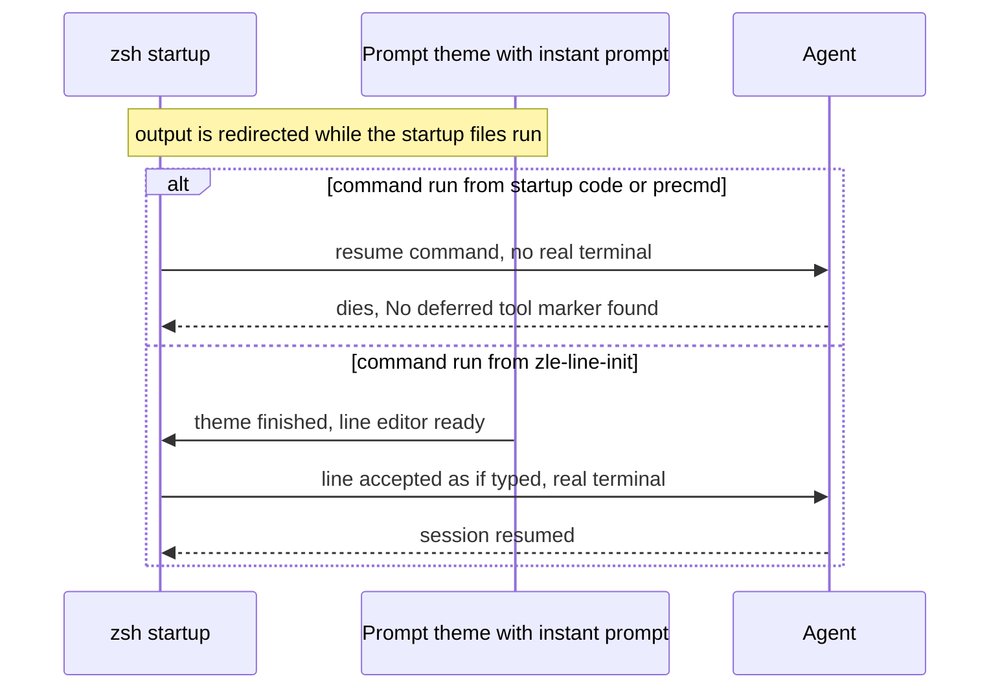
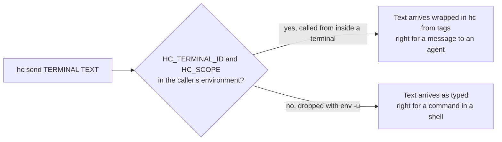
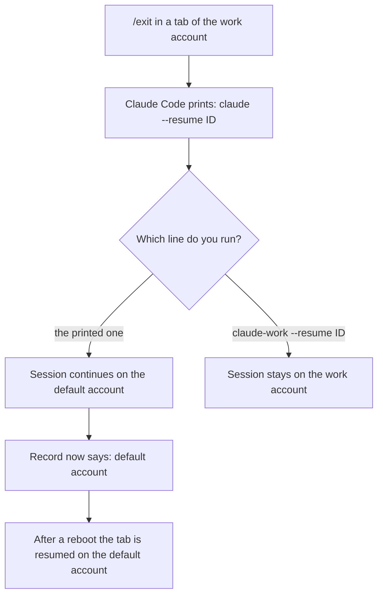

# Shell pitfalls

[Guide](../README.en.md)

Four things in a normal shell setup broke agent tabs or put them on the wrong account. None of them is a bug of the multiplexer.

## 1. A plugin that wraps the shell in its own pseudo-terminal

Seen with the smart-suggestion zsh plugin in its proxy mode (on by default at the time, skipped only inside tmux). The plugin starts a nested shell inside its own pty.



Three separate effects:

| Where | What broke | Marker to test for |
|---|---|---|
| Terminals of the herdr TUI | Agents are found by the terminal's foreground process. That process was now the plugin, so the agent list was empty and status stayed unknown | `HERDR_ENV=1` |
| Menu entries of the Herdr app | The app launches an entry as `zsh -lic '"$@"; exec "$0" -li' zsh <cmd>`. The nested shell started first, `<cmd>` never ran, and the tab was a plain shell with an agent's name | `ZSH_EXECUTION_STRING` is set |
| Terminals recovered after a reboot | They are plain `zsh -l` with neither marker above, so the proxy was back | `HC_TERMINAL_ID` is set |

Fix: turn the proxy off in those three cases, before the plugin is sourced. See [`shell/zshrc-proxy-guards.zsh`](../shell/zshrc-proxy-guards.zsh).

Notes:

- `hc run <cmd>` does not go through zsh, so it does not reproduce the second case. Test a menu entry with the full `zsh -lic` form.
- Reinstalling such a plugin can rewrite `~/.zshrc` and drop the guard lines. Check after an update.
- The same applies to anything that puts its own process between the terminal and your programs. First check when agents are not detected: what is the terminal's foreground process?

The second case had a nasty follow-up: the tab was named after one account, the user typed the usual start command in what was a plain shell, and worked for a while on a different account than the tab name said.

## 2. Instant prompt and commands at shell startup

The resume command must run with a real terminal on stdin and stdout. A prompt theme with an "instant prompt" (powerlevel10k for example) redirects output during startup. An agent started from plain startup code or from `precmd` then has no terminal. Claude Code died there with "No deferred tool marker found in the resumed session".

Fix: run the command from `zle-line-init`, as if it had been typed:

```zsh
BUFFER=" $cmd"
zle accept-line
```

See [`shell/zshrc-resume-trigger.zsh`](../shell/zshrc-resume-trigger.zsh). By then the theme is done with its tricks, the line shows in the terminal like a typed one, and ctrl+c works as usual.



## 3. Talking to another terminal from inside a terminal

`hc send <terminal> '<text>'` run from inside a herdr-core terminal wraps the text in `<hc from=...>` tags, so the receiver knows another terminal sent it. That is right for a message to an agent. It is wrong when you want to type a command into a shell.

```
env -u HC_TERMINAL_ID -u HC_SCOPE hc send <terminal> '<command>'
```



Scripts that drive a separate test core from inside a tab should drop those variables as well (and `HC_TERMINAL_SOCKET`), or simply start from a clean environment as [`tools/probe-env.zsh`](../tools/probe-env.zsh) does.

## 4. The command an agent prints when it quits

After `/exit` Claude Code prints `claude --resume <id>`. With several accounts, running that line continues the session on the default account, whatever the tab is called, and that is what the resume tool then records and restores. The form to use is the launcher: `claude-<label> --resume <id>`.



The record stores what the session really ran as. A wrong account after a reboot usually means the session was already on that account before the reboot.

The whole setup with one account per tab, and how to tell which account a tab is on: [one account per tab](claude-accounts.md).
