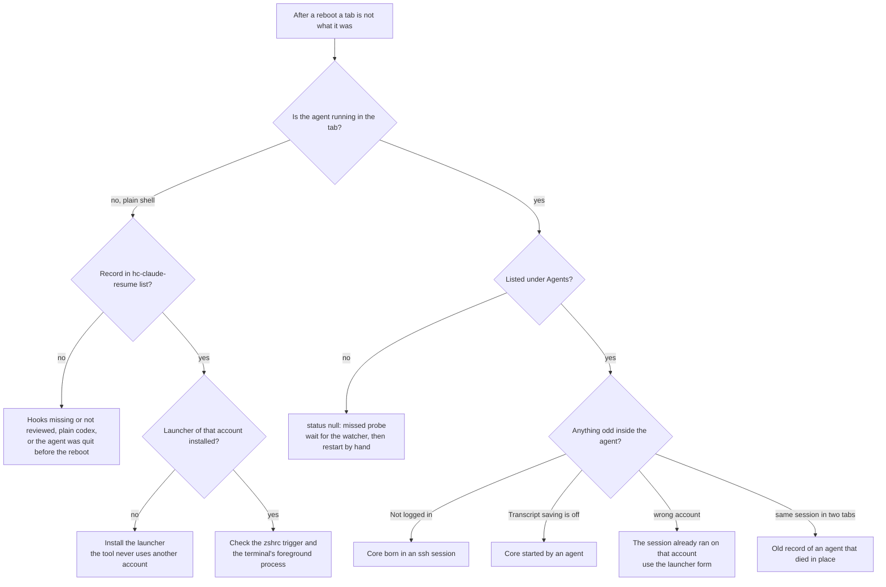
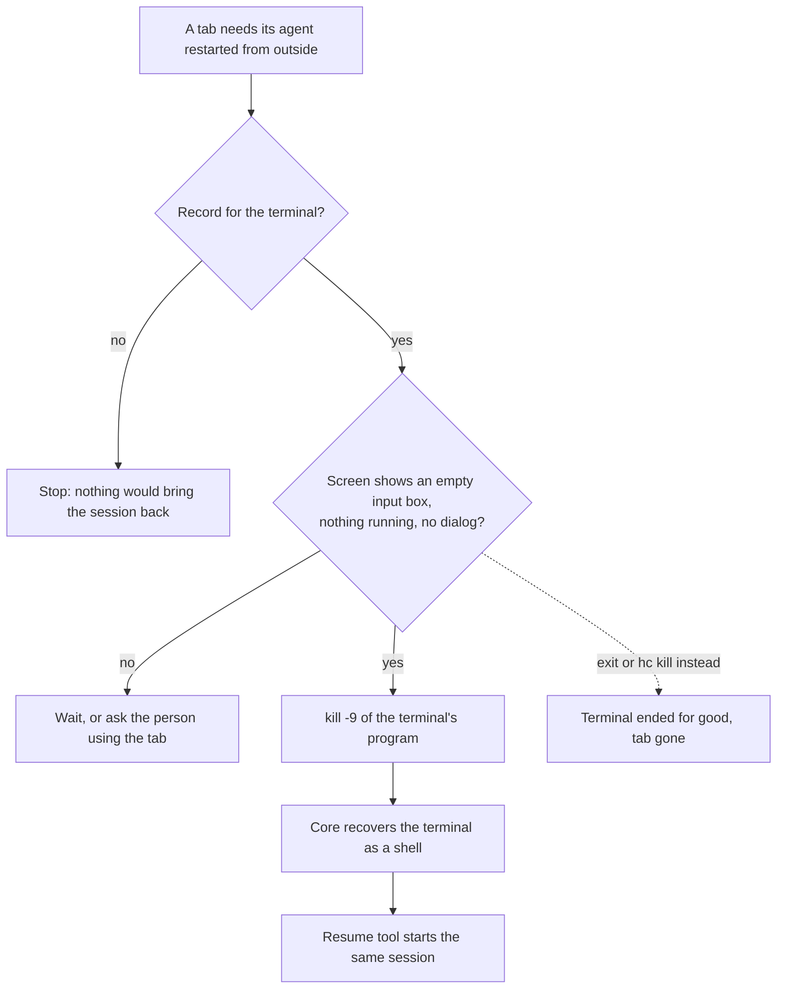

# Troubleshooting

[Guide](../README.en.md)

Start from what you see. Each row names the first thing to check, because several of these problems look alike and have different causes.

## After a reboot

The short way through the table below:



| You see | Check first | Likely cause and fix |
|---|---|---|
| Tabs are back, but they are plain shells | `hc-claude-resume list` and `events.log` | No record: the hooks were not installed, not trusted yet (Codex), or the agent was quit before the reboot (`prompt_input_exit` in the log, expected). See [resume](resume-after-reboot.md) |
| A record exists, the tab is still a shell | The `~/.zshrc` trigger and the foreground process of the terminal | Trigger missing or placed before the prompt theme; a plugin wraps the shell. See [shell pitfalls](shell-pitfalls.md) |
| Claude Code tab stays a shell, log is silent | `command -v claude-<label>` | The account launcher is missing. The tool never falls back to another account |
| Agent runs, but is missing from the Agents list | `hc get <terminal> --json`: `status: null`, agent in `foreground` | Missed status probe. See [root cause](missing-agents-root-cause.md). Wait a few minutes for the watcher, then look for `giving up` in the log |
| Agent died with "No deferred tool marker found in the resumed session" | Where the resume command is run from | It ran without a terminal (startup code or `precmd` under an instant prompt). Use the `zle-line-init` trigger |
| "Not logged in", status line without account | `ps` for a `herdr-core serve` under an ssh session; the Keychain exit code | The core was born in an ssh session. See [core environment](core-environment.md) |
| Banner "Transcript saving is off" in a normal tab | Variable names in the core's environment | The core was started by an agent. See [core environment](core-environment.md) |
| The same session opens in two tabs | `hc-claude-resume list` for two records with one session id | An old record from an agent that died in place. Current versions resume only one. Close the extra tab's agent with `/exit` |
| Codex tab is a shell, other agents came back | How that tab was started | Plain `codex` runs in the shared server and cannot be recorded. Use `codex --no-daemon`. See [Codex and Grok](codex-and-grok.md) |
| A tab on the wrong account | The record's `account` | The session already ran on that account before the reboot, often from running the `claude --resume <id>` line printed at exit. Use the launcher form. See [one account per tab](claude-accounts.md) |
| Tabs come back slowly, one by one | Nothing | The start queue. About 3 s per agent on a calm machine. The prompt says it is waiting; ctrl+c skips the wait for that tab |
| A tab restarted itself minutes after the reboot | `events.log`: `restarting the agent` | The watcher repaired a missed probe. Same session, scrollback kept |

## Any time

| You see | Check first | Likely cause and fix |
|---|---|---|
| A long running session has no status | Its screen, then `hc get` | It never got its probe answered, or it is a fresh session started under load. Restart the agent in that tab (below) |
| No agent is detected in any terminal | The terminal's foreground process | A wrapper process between terminal and agent. See [shell pitfalls](shell-pitfalls.md) |
| A menu entry opens a plain shell | Run the entry as `zsh -lic '"$@"; exec "$0" -li' zsh <cmd>` by hand | The command never ran because a plugin started a nested shell first |
| Text sent with `hc send` arrives wrapped in tags | Whether you sent it from inside a terminal | Drop `HC_TERMINAL_ID` and `HC_SCOPE` for that call. See [shell pitfalls](shell-pitfalls.md) |

## Restarting the agent of one tab

Inside the tab, when you are at the keyboard:

```
/exit
claude-<label> --resume <session id>
```

From outside, on a machine with the resume tool installed:

```
hc read <terminal> --lines 0          # 1. look: empty input box, nothing running, no dialog
hc get <terminal> --json              # 2. take "pid": the terminal's program (the tab's shell)
kill -9 <that pid>                    # 3. the core recovers a shell, the tool resumes the session
```

Conditions for the second way, all of them:

- A record exists for the terminal (`hc-claude-resume list`).
- The agent is idle and its input box is empty. With `status: null` you can only know that from the screen.
- No question, permission prompt or dialog is open.
- Nothing else that matters runs under that shell.



Never use `exit` in the tab's shell or `hc kill` for this. Both end the terminal for good and the tab is gone.

An agent that works for you should ask before doing this to a tab you are using, and must not do it to the tab it is running in without a plan for what happens to its own turn.

## Turning parts off

| Want | How |
|---|---|
| No automatic restarts | `touch ~/.local/state/hc-claude-resume/<core>/no-status-retry` |
| No resume at all for one tab | Delete `<terminal>.json` in the same folder |
| No resume anywhere | Remove the trigger block from `~/.zshrc`. The hooks only write records |
| More detail in the log | `touch .../debug` in the same folder |

## What to send upstream

For the missed probe, the useful report is the one "Terminal capabilities" line from `claude --debug-file <file>` of a failing session, next to the same line of a healthy one, plus the fact that the terminal answered quickly. Read the debug log before sharing any of it: it can contain paths and other private details.
